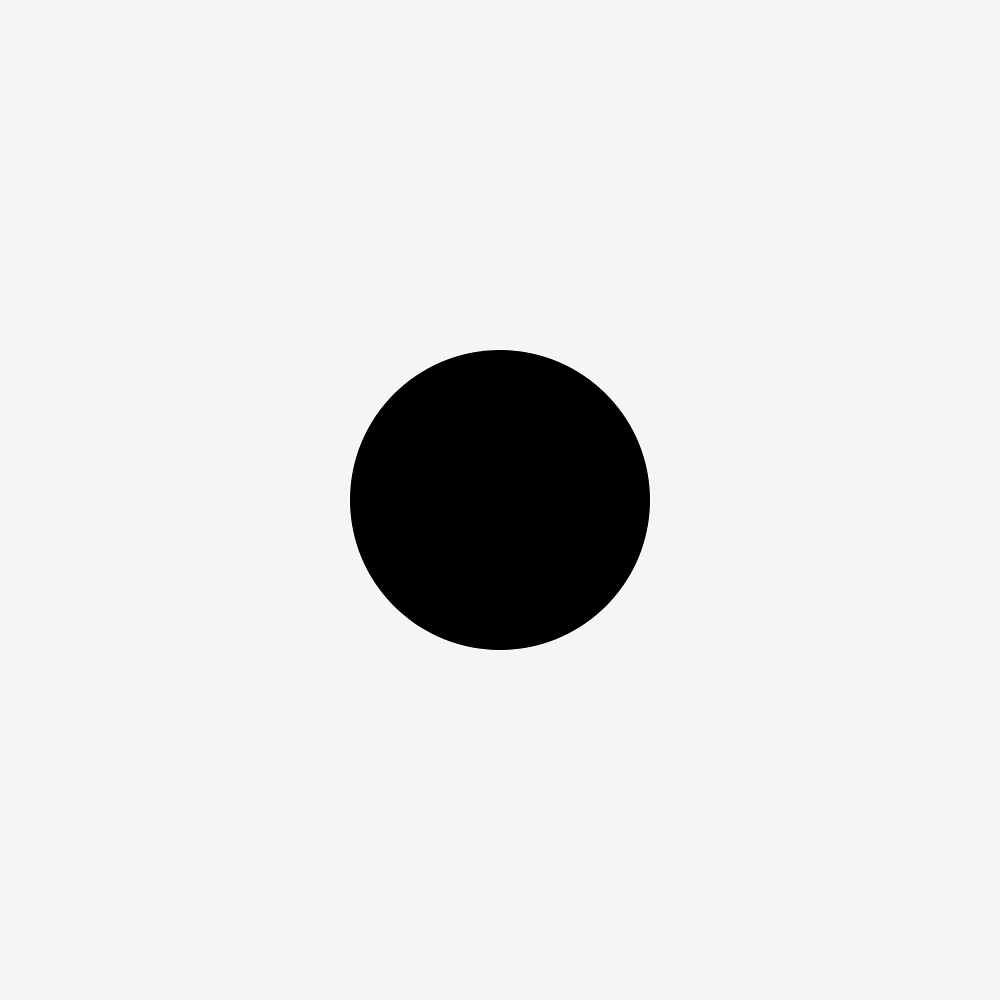
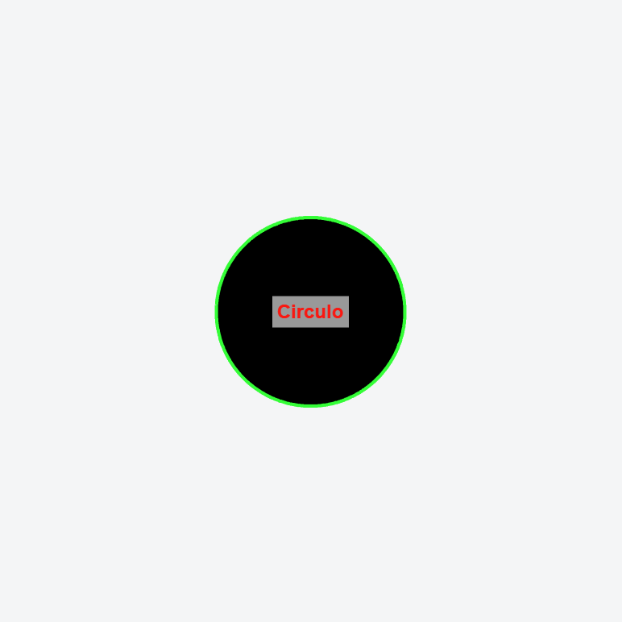
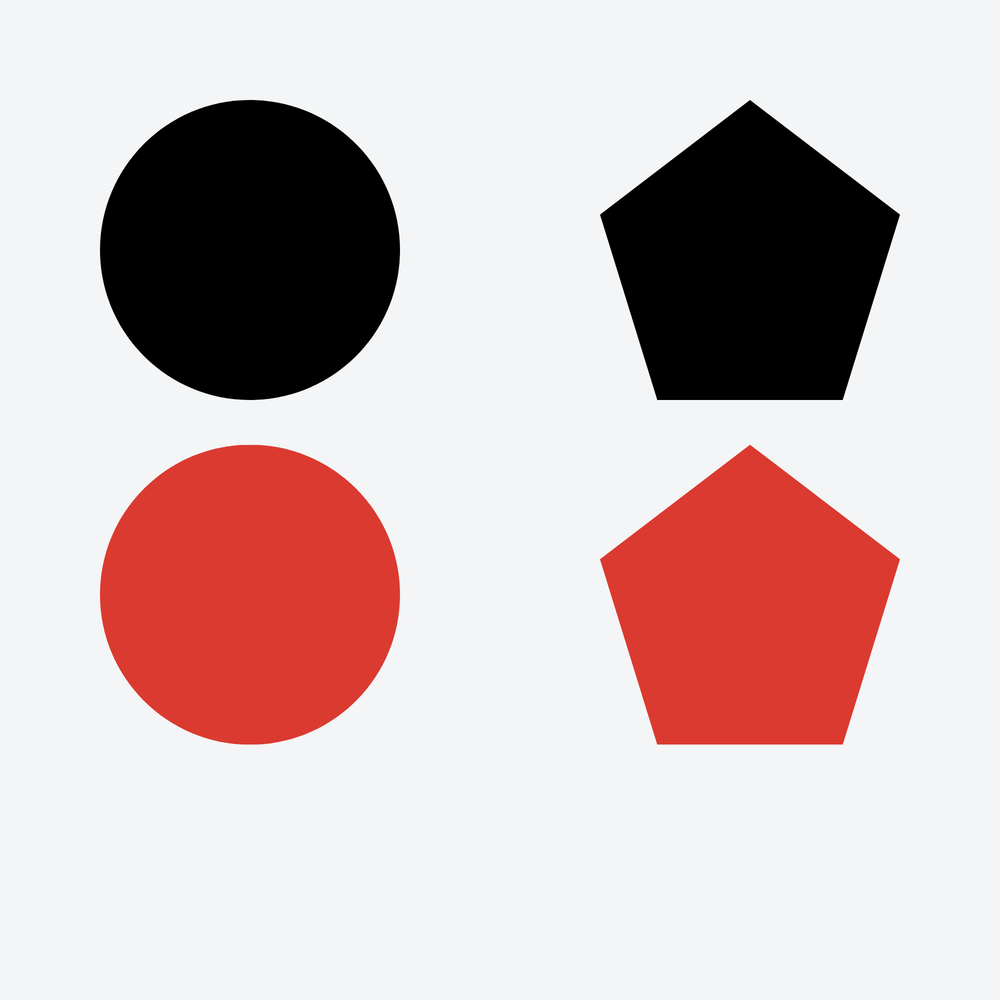
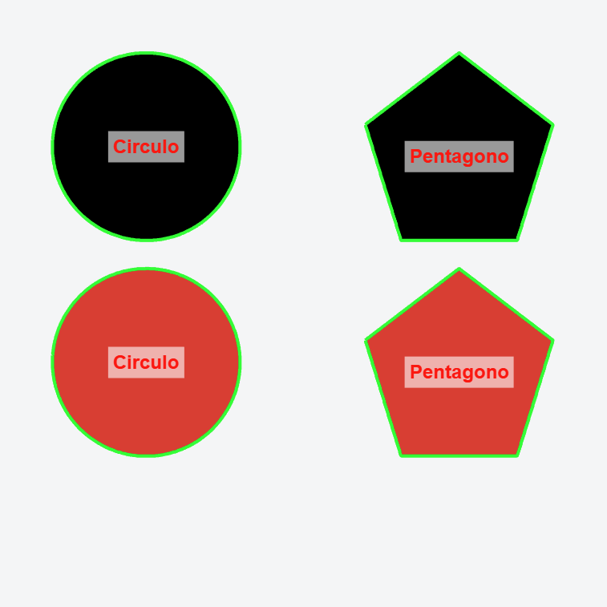
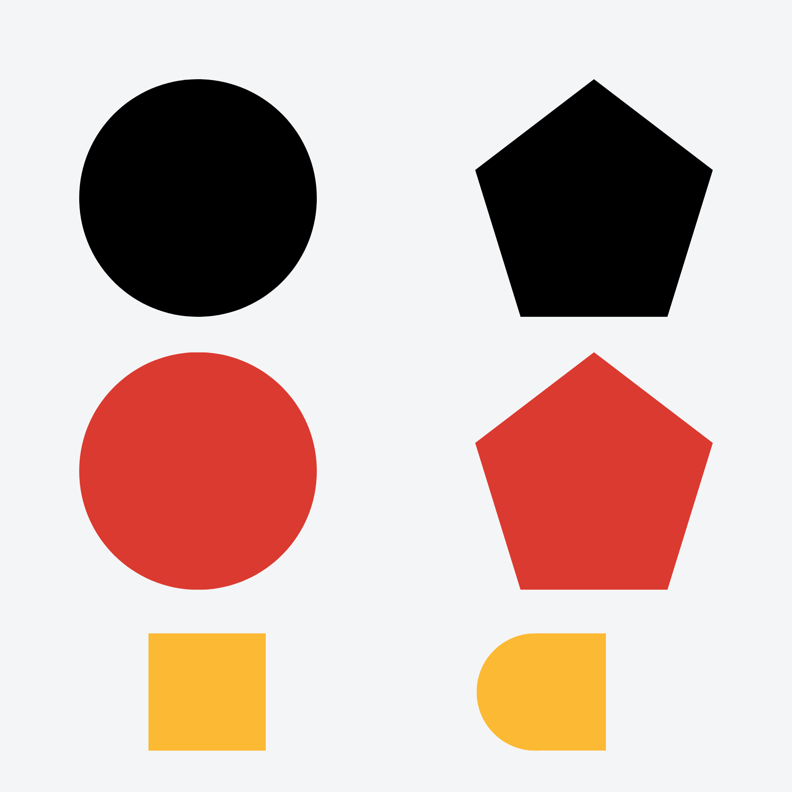
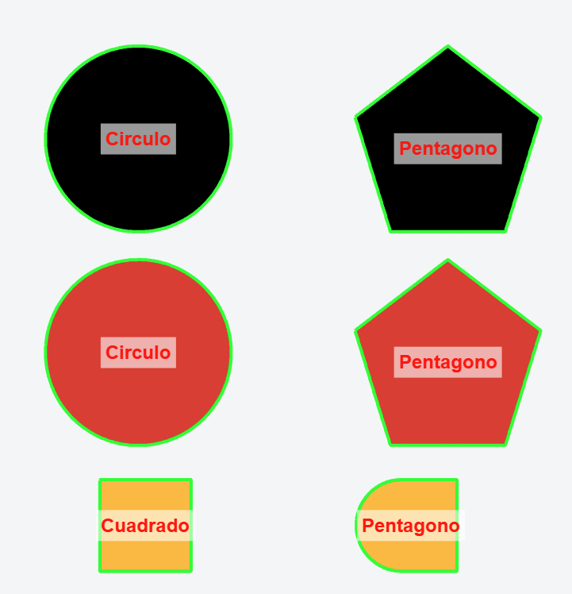

# Primera Pruebas de vision computacional en matlab
**Detección de figuras sin tomar en cuenta el color**

## Descripcion y requisitos

la función **DETECTAR_FORMAS**  Detecta cuadrados, círculos, pentágonos, en una imagen.

Uso:   **detectar_formas('formas.png')**.

**'formas.png'** es una imagen que debe estar guardada en la misma direccion que tu código.

Requiere: **Image Processing Toolbox**

### Metodología
Pipeline:
 1) Leer imagen 
 2) Escala de grises 
 3) Binarizar
 4) Limpiar (morfología)  
 5) Medir regiones (regionprops)
 6) Contar esquinas del contorno  
 7) Clasificar y dibujar


## Explicación del código 
El código completo se encuentra en [Anexos](#Anexos) de este reporte 

```Matlab
function detectar_formas(nombreImagen)

    if nargin < 1
        nombreImagen = 'formas.png';
    end

    %% 1) LEER LA IMAGEN
    I = imread(nombreImagen);

    %% 2) y 3) SEGMENTAR POR DIFERENCIA DE COLOR CON EL FONDO
    Id = im2double(I);
    if size(Id,3) == 1
        Id = repmat(Id, [1 1 3]);
    end
```

`detectar_formas` es el nombre de nuestra función creada

`(nombreImagen)`: es el parametro que requiere nuestra función el cual debe ser la imagen que vamos a procesar

`nargin`: significa Number of Input Arguments, esta parte nos ayuda ya que si manualmente no ponemos una imagen que queramos (es decir pasamos la funcion con parametro 0) automaticamente nos llama a la imagen png llamada **formas.png**.

`imread`: es lo que lee nuestra imagen elegida.

`I`: es la imagen original.

`im2double()`: convierte los valores de los píxeles al tipo de dato double. Si la imagen original tiene valores entre 0 y 255, los convierte a valores entre 0 y 1.

`if size(Id,3) == 1`: Comprobar si la imagen es en escala de grises. Aquí utilizamos size() para conocer las dimensiones de la imagen.

Una imagen puede tener tres dimensiones:
- Dimensión 1: Alto (filas).
- Dimensión 2: Ancho (columnas).
- Dimensión 3: Canales de color.

Entonces, `size(Id,3)` obtiene el número de canales de color. Si es igual a 1, significa que la imagen está en escala de grises.


`Id = repmat(Id, [1 1 3])`: convierte la imagen en un formato de 3 canales ya que una imagen RGB tiene 3 canales pero una de grises no, lo cual se ocupara para funciones en el resto del programa.

¿Qué significa [1 1 3]?
- 1: No repetir las filas.
- 1: No repetir las columnas.
- 3: Repetir tres veces la tercera dimensión.

```Matlab
% Color del fondo = mediana de los píxeles del borde de la imagen
    bordes = [squeeze(Id(1,:,:)); squeeze(Id(end,:,:)); ...
              squeeze(Id(:,1,:)); squeeze(Id(:,end,:))];
    fondo = median(bordes, 1);
```
Suponemos que los bordes de la imagen contienen principalmente el fondo. Por eso tomamos los píxeles que están en los cuatro extremos de la imagen.

| Elemento | Descripción |
| :--- | :--- |
| `Id(1,:,:)` | Primera fila (borde superior). |
| `Id(end,:,:)` | Última fila (borde inferior). |
| `Id(:,1,:)` | Primera columna (borde izquierdo). |
| `Id(:,end,:)` | Última columna (borde derecho). |


`squeeze(Id(1,:,:))`: Elimina las dimensiones que tienen tamaño 1. Esto facilita juntar los cuatro bordes en una sola matriz

Después unicamente calculamos la mediana para tener un color.

```Matlab    
    % Distancia de cada píxel al color del fondo (en RGB)
    dif = sqrt(sum((Id - reshape(fondo, 1, 1, 3)).^2, 3));
```

Esta línea calcula qué tan diferente es cada píxel respecto al color del fondo.

Se basa en la distancia euclidiana en RGB. El vector del fondo tiene tres valores: [R G B]

Con `reshape()` se reorganiza en una matriz de dimensiones:
1 × 1 × 3

Para poder compararlo con todos los píxeles de Id, que tiene dimensiones (Alto × Ancho × 3).

MATLAB utiliza expansión implícita para realizar esa resta en todos los píxeles.

`Id - reshape(fondo, 1, 1, 3)`
Compara cada canal del píxel con el canal correspondiente del fondo. Eleva cada diferencia al cuadrado. Esto evita que las diferencias negativas se cancelen con las positivas. Suma las diferencias cuadráticas de R, G y B. Y el 3 indica que la suma se realiza sobre la tercera dimensión, es decir, los canales de color.

`sqrt(...)` calcula la raiz cuadrada 

Se obtiene la distancia euclidiana con:
$$
d = \sqrt{(R-R_f)^2 + (G-G_f)^2 + (B-B_f)^2}
$$

Donde:
- \(R,G,B\): color del píxel.
- \(R_f,G_f,B_f\): color estimado del fondo.
- \(d\): distancia entre ambos colores.
Cuanto mayor sea dif, más diferente es el píxel respecto al fondo

```Matlab
    % Todo lo que se aleja del fondo es objeto
    BW = dif > 0.15;
```
Aquí se establece un umbral (threshold).

Se compara la distancia de cada píxel con 0.15.
- Si dif > 0.15, el píxel se considera parte de un objeto.
- Si dif <= 0.15, el píxel se considera parte del fondo.
El resultado es una imagen binaria:
- 1 (blanco): objeto.
- 0 (negro): fondo.

el lumbral 0.15 es elegido manualmente. Determina qué tanta diferencia de color debe existir para considerar que un píxel pertenece a una figura.

Cosas que tendremos que conciderar en pruebas son que:

- Umbral pequeño: detecta diferencias de color muy pequeñas, pero puede incluir ruido.
- Umbral grande: ignora diferencias pequeñas, pero puede perder partes de los objetos.

```Matlab
    % Si el fondo es blanco y las figuras oscuras, queda al revés.
    borde = [BW(1,:), BW(end,:), BW(:,1)', BW(:,end)'];
    if mean(borde) > 0.5
        BW = ~BW;
    end
```
Este pedazo de código nos ayuda a que si el fondo es blanco y las figuras oscuras lo invierte

```Matlab
%% 4) LIMPIAR LA IMAGEN BINARIA
    BW = imfill(BW, 'holes');          % rellena huecos dentro de las figuras
    BW = bwareaopen(BW, 200);          % elimina manchas pequeñas (ruido)
    BW = imopen(BW, strel('disk', 2)); % suaviza bordes con morfología
```

```matlab
props = regionprops(BW, 'Area', 'Perimeter', 'Centroid', ...
    'BoundingBox', 'Solidity', 'MajorAxisLength', 'MinorAxisLength', 'Extent');

fronteras = bwboundaries(BW, 'noholes');
```

Se utiliza `regionprops()` para obtener las características geométricas de cada objeto detectado:

- **Area:** cantidad de píxeles que ocupa la figura.
- **Perimeter:** longitud de su contorno.
- **Centroid:** coordenadas del centro de la figura.
- **BoundingBox:** rectángulo que delimita el objeto.
- **Solidity:** relación entre el área del objeto y el área de su envolvente convexa. Permite identificar qué tan compacta es una figura.
- **MajorAxisLength:** longitud del eje mayor.
- **MinorAxisLength:** longitud del eje menor.
- **Extent:** proporción del área del objeto respecto al área de su `BoundingBox`. Permite conocer qué tanto espacio ocupa la figura dentro del rectángulo que la contiene.

Por otro lado, `bwboundaries()` obtiene las coordenadas de los contornos de cada objeto, sin considerar agujeros internos (`noholes`).


Se recorre cada región para analizar su contorno y determinar a qué figura geométrica pertenece.

```matlab
P = fronteras{k};
P = [P(:,2), P(:,1)];
P(end,:) = [];

nEsquinas = contar_esquinas(P);
```

Se recupera el contorno de cada objeto. Como MATLAB entrega las coordenadas en formato `[fila, columna]`, se intercambian para trabajar con `[x, y]`. También se elimina el último punto porque repite el primero al cerrar el contorno.

Posteriormente, `contar_esquinas()` determina cuántos vértices tiene la figura.

### Características geométricas

```matlab
circ = 4*pi*props(k).Area / props(k).Perimeter^2;

relAspecto = props(k).MajorAxisLength / props(k).MinorAxisLength;
```

Se calculan dos características adicionales:

- **Circularidad (`circ`):** mide qué tan parecida es una figura a un círculo. Un valor cercano a 1 indica una forma circular; valores menores indican formas más alargadas o con esquinas.
- **Relación de aspecto (`relAspecto`):** divide el eje mayor entre el menor. Si el resultado es cercano a 1, la figura tiene dimensiones similares; si es mayor, presenta una forma más alargada.


```matlab
if nEsquinas == 4
    if relAspecto < 1.15
        nombre = 'Cuadrado';
    else
        nombre = 'Rectangulo';

    end

elseif nEsquinas == 5
    nombre = 'Pentagono';

elseif nEsquinas >= 6 && circ > 0.80 && props(k).Solidity > 0.9
    nombre = 'Circulo';

elseif nEsquinas >= 1 && nEsquinas <= 2 && ...
       props(k).Extent > 0.86 && props(k).Extent < 0.95 && ...
       props(k).Solidity > 0.95
    nombre = 'Figura D';

else
    nombre = 'Desconocida';
end
```

La clasificación se realiza mediante condiciones `if/elseif`, combinando el número de esquinas con las características geométricas.

Las condiciones se establecen de la siguiente manera:


- **Cuadrado:** tiene 4 esquinas y una relación de aspecto menor a 1.15, indicando que sus lados tienen dimensiones similares.
- **Rectángulo:** tiene 4 esquinas, pero una relación de aspecto mayor o igual a 1.15.
- **Pentágono:** se identifica por tener 5 esquinas.
- **Círculo:** presenta 6 o más esquinas aproximadas debido a la discretización del contorno, circularidad superior a 0.80 y solidez mayor a 0.9.

**Figura D:** se clasifica mediante reglas específicas que determinamos nosotros ya que fue una figura que concideramos facil para el griper y que sigue siendo bastante identificable, la demoninamos figura D por su parecido a aesta. su contorno no necesariamente conserva todas sus esquinas después de la simplificación. Por su geometría particular, puede presentar entre 1 y 2 esquinas detectadas. Por eso no basta con contar vértices: se utilizan también `Extent` y `Solidity` para reconocerla. Sin embargo en los resultados nos daremos cuenta que no detecta muy bien esta figura, por lo queen eel segundo test tendremos que mejorar las reglas especificas que la detectan.

- `Extent > 0.86 && Extent < 0.95`: establece que la figura ocupa entre el 86 % y el 95 % del rectángulo que la contiene. Este intervalo funciona como una característica geométrica particular de la Figura D.
- `Solidity > 0.95`: indica que la figura ocupa más del 95 % del área de su envolvente convexa, por lo que tiene un contorno compacto y con pocas concavidades.


```matlab
plot(P(:,1), P(:,2), 'g', 'LineWidth', 2);

c = props(k).Centroid;

text(c(1), c(2), nombre, 'Color', 'r', ...
    'FontSize', 12, 'FontWeight', 'bold', ...
    'HorizontalAlignment', 'center');
```

Finalmente, se dibuja el contorno de cada figura en color verde y se coloca su clasificación en rojo, utilizando el centroide como punto de referencia. También se imprimen las características geométricas en la consola para verificar los resultados.

## Funciones auxiliares: simplificación del contorno

### `contar_esquinas(P)`

Esta función utiliza el algoritmo **Douglas-Peucker** para reducir la cantidad de puntos del contorno y conservar únicamente los que representan cambios importantes en su dirección.

```matlab
perim = sum(vecnorm(diff([P; P(1,:)]), 2, 2));
tol = 0.025 * perim;
```

Primero calcula el perímetro y establece una tolerancia equivalente al 2.5 % de este. Después divide el contorno cerrado en dos curvas para poder aplicar la simplificación.

```matlab
k1 = douglas_peucker(curva1, tol);
k2 = douglas_peucker(curva2, tol);

n = sum(k1) + sum(k2) - 2;
```

Se cuentan los puntos importantes conservados en ambas curvas, restando los dos puntos compartidos para evitar contarlos doble.

### `douglas_peucker(P, tol)`

Implementa el algoritmo de simplificación recursiva.

1. Conserva el primer y último punto del contorno.
2. Calcula la distancia perpendicular de los demás puntos a la línea que une los extremos.
3. Busca el punto con mayor distancia.
4. Si supera la tolerancia, divide la curva en dos y repite el procedimiento.
5. Si no supera la tolerancia, descarta los puntos intermedios.

De esta manera se eliminan pequeñas irregularidades del contorno y se conservan sus vértices principales.

## Resultados
Aqui veremos las imagenes originales y su resutado despues de ser procesadas con una conclusion sobre las mejoras que deben realizarce. 

<table>
  <tr>
    <th>Imagen original</th>
    <th>Imagen procesada</th>
  </tr>
  <tr>
    <td></td>
    <td></td>
  </tr>
</table>

<table>
  <tr>
    <th>Imagen original</th>
    <th>Imagen procesada</th>
  </tr>
  <tr>
    <td></td>
    <td></td>
  </tr>
</table>

<table>
  <tr>
    <th>Imagen original</th>
    <th>Imagen procesada</th>
  </tr>
  <tr>
    <td></td>
    <td></td>
  </tr>
</table>

## Conclusiones

A partir de los resultados obtenidos, concluimos que completar el ajedrez añadiendo más figuras podría complicar su reconocimiento visual. Por ello, simplificaremos el diseño utilizando las mismas figuras y distinguiendo las piezas por su color. Además, procuraremos que cada figura tenga una cantidad distinta de vértices, de modo que esta característica también contribuya a su identificación. Como la cámara observará el tablero desde arriba, esperamos que la distorsión de las figuras no represente un problema importante.


## Anexos

```Matlab
function detectar_formas(nombreImagen)

    if nargin < 1
        nombreImagen = 'formas3.png';
    end

    %% 1) LEER LA IMAGEN
    I = imread(nombreImagen);

    %% 2) y 3) SEGMENTAR POR DIFERENCIA DE COLOR CON EL FONDO
    Id = im2double(I);
    if size(Id,3) == 1
        Id = repmat(Id, [1 1 3]);
    end
    
    % Color del fondo = mediana de los píxeles del borde de la imagen
    bordes = [squeeze(Id(1,:,:)); squeeze(Id(end,:,:)); ...
              squeeze(Id(:,1,:)); squeeze(Id(:,end,:))];
    fondo = median(bordes, 1);
    
    % Distancia de cada píxel al color del fondo (en RGB)
    dif = sqrt(sum((Id - reshape(fondo, 1, 1, 3)).^2, 3));
    
    % Todo lo que se aleja del fondo es objeto
    BW = dif > 0.15;

    % Si el fondo es blanco y las figuras oscuras, queda al revés.
    % Truco: si la mayoría de los píxeles del borde son blancos, invertimos.
    borde = [BW(1,:), BW(end,:), BW(:,1)', BW(:,end)'];
    if mean(borde) > 0.5
        BW = ~BW;
    end

    %% 4) LIMPIAR LA IMAGEN BINARIA
    BW = imfill(BW, 'holes');          % rellena huecos dentro de las figuras
    BW = bwareaopen(BW, 200);          % elimina manchas pequeñas (ruido)
    BW = imopen(BW, strel('disk', 2)); % suaviza bordes con morfología

    %% 5) MEDIR CADA REGIÓN
    props = regionprops(BW, 'Area', 'Perimeter', 'Centroid', ...
    'BoundingBox', 'Solidity', 'MajorAxisLength', 'MinorAxisLength', 'Extent');

    % Contornos de cada objeto (misma numeración que regionprops)
    fronteras = bwboundaries(BW, 'noholes');

    %% 6) y 7) CLASIFICAR Y DIBUJAR
    figure; imshow(I); hold on;
    title('Formas detectadas');

    for k = 1:numel(props)
        P = fronteras{k};
        P = [P(:,2), P(:,1)];          % [fila col] -> [x y]
        P(end,:) = [];                 % el último punto repite al primero

        nEsquinas = contar_esquinas(P);

        % Circularidad: 1 = círculo perfecto, menor = más "picudo"
        circ = 4*pi*props(k).Area / props(k).Perimeter^2;
        relAspecto = props(k).MajorAxisLength / props(k).MinorAxisLength;

        % --- Reglas de decisión ---
        if nEsquinas == 3
            nombre = 'Triangulo';
        elseif nEsquinas == 4
            if relAspecto < 1.15
                nombre = 'Cuadrado';
            else
                nombre = 'Rectangulo';
            end
        elseif nEsquinas == 5
            nombre = 'Pentagono';
        elseif nEsquinas >= 6 && circ > 0.80 && props(k).Solidity > 0.9
            nombre = 'Circulo';

        elseif nEsquinas >= 1 && nEsquinas <= 2 && ...
                props(k).Extent > 0.86 && props(k).Extent < 0.95 && ...
                props(k).Solidity > 0.95
            nombre = 'Figura D';

        else
            nombre = 'Desconocida';
        end

        % Dibujar contorno y etiqueta
        plot(P(:,1), P(:,2), 'g', 'LineWidth', 2);
        c = props(k).Centroid;
        text(c(1), c(2), nombre, 'Color', 'r', 'FontSize', 12, ...
            'FontWeight', 'bold', 'HorizontalAlignment', 'center', ...
            'BackgroundColor', [1 1 1 0.6]);

        fprintf(['Objeto %d: %s | esquinas=%d circ=%.2f ' ...
            'extent=%.2f solidez=%.2f aspecto=%.2f\n'], ...
            k, nombre, nEsquinas, circ, props(k).Extent, ...
            props(k).Solidity, relAspecto);
    end
    hold off;
end


%  FUNCIONES AUXILIARES

function n = contar_esquinas(P)

    % Tolerancia: 2.5% del perímetro. Si detecta de más/menos, ajústala.
    perim = sum(vecnorm(diff([P; P(1,:)]), 2, 2));
    tol = 0.025 * perim;

    % Un contorno cerrado se parte en dos curvas abiertas usando el
    % punto más lejano al primero.
    [~, i2] = max(vecnorm(P - P(1,:), 2, 2));
    curva1 = P(1:i2, :);
    curva2 = [P(i2:end, :); P(1,:)];

    k1 = douglas_peucker(curva1, tol);
    k2 = douglas_peucker(curva2, tol);

    n = sum(k1) + sum(k2) - 2;   % los 2 puntos de unión se cuentan doble
end

function keep = douglas_peucker(P, tol)
% Devuelve un vector lógico indicando qué puntos se conservan.
    n = size(P,1);
    keep = false(n,1);
    keep([1 n]) = true;
    if n < 3, return; end

    a = P(1,:);  b = P(n,:);  ab = b - a;  L = norm(ab);
    if L == 0
        d = vecnorm(P - a, 2, 2);
    else
        % distancia de cada punto a la recta a-b
        d = abs(ab(1)*(P(:,2)-a(2)) - ab(2)*(P(:,1)-a(1))) / L;
    end

    [dmax, i] = max(d);
    if dmax > tol
        keep(1:i) = douglas_peucker(P(1:i,:), tol);
        keep(i:n) = douglas_peucker(P(i:n,:), tol);
    end
end
```


