# Tercera prueba de visión computacional en MATLAB
**Detección de formas y colores sobre un tablero blanco y negro**


En esta tercera prueba buscamos adaptar nuestro sistema de visión computacional para reconocer figuras de colores colocadas sobre un tablero de ajedrez blanco y negro.

El principal problema de la prueba anterior era que la segmentación se realizaba calculando la diferencia entre el color de cada píxel y el color estimado del fondo. Al utilizar un tablero con casillas blancas y negras, este procedimiento podía confundir el fondo con los objetos.

Por esta razón, se modificó el método de segmentación para utilizar la saturación de los colores, permitiendo ignorar las casillas del tablero y detectar principalmente las figuras coloreadas.

El código completo se encuentra en [Anexos](#Anexos) de este reporte 

### 1. Nuevo método de segmentación: HSV

Este es el cambio más importante de esta versión. En la prueba anterior utilizábamos la diferencia RGB entre los píxeles de la imagen y el color estimado del fondo. Ahora utilizamos el espacio de color HSV para separar las figuras del tablero.

```matlab
HSV = rgb2hsv(Id);
S = HSV(:,:,2);
V = HSV(:,:,3);

BW = (S > 0.20) & (V > 0.15);
```

Primero se convierte la imagen de RGB a HSV mediante `rgb2hsv()`.

Después se separan dos componentes:

- **S (Saturation):** representa la saturación o intensidad del color.
- **V (Value):** representa el brillo del píxel.

La idea es que las casillas blancas y negras del tablero tienen una saturación cercana a cero, mientras que las figuras de colores presentan una saturación mayor.

Por eso establecemos dos condiciones:

- `S > 0.20`: el píxel debe tener suficiente saturación para considerarse parte de una figura coloreada.
- `V > 0.15`: el píxel debe tener un brillo mínimo para evitar incluir regiones demasiado oscuras.


El resultado es una imagen binaria:

- **1 (blanco):** píxeles que cumplen las condiciones y se consideran parte de los objetos.
- **0 (negro):** píxeles que no cumplen las condiciones y se consideran fondo.

De esta manera, el tablero blanco y negro se ignora porque sus casillas tienen poca o ninguna saturación.

Algo que ahora tendremos que tener en cuenta para la elección de colores en nuestras piezas es que este método funciona principalmente con figuras de colores saturados. Las figuras negras, grises o blancas no podrán segmentarse correctamente utilizando estas condiciones, ya que sus valores de saturación son bajos.


## 2. Ajustes en el reconocimiento de colores

Se realizaron dos pequeños cambios en la función `nombre_color()`.

Los cuales son los intervalos del gris que paso de 0.25 a 0.15 para evitar que algunos colores poco saturados sean clasificados incorrectamente como grises. Y también se modificó el límite superior del intervalo del cian de 200 a 190 para delimitar mejor su clasificación y evitar que algunos tonos cercanos al azul sean identificados como cian.

El resto de los intervalos HSV se mantiene igual que en la segunda prueba.

Aunque la mayoria de colores se eliminaran en el código final tenemos esta variedad para que a la hora de hacer pruebas veamos que colores tienen mejores resultados

## 3. Resultados
Aqui veremos las imagenes originales y su resutado despues de ser procesadas con una conclusion sobre las mejoras que deben realizarce.

<table>
  <tr>
    <th>Imagen original</th>
    <th>Imagen procesada</th>
  </tr>
  <tr>
    <td>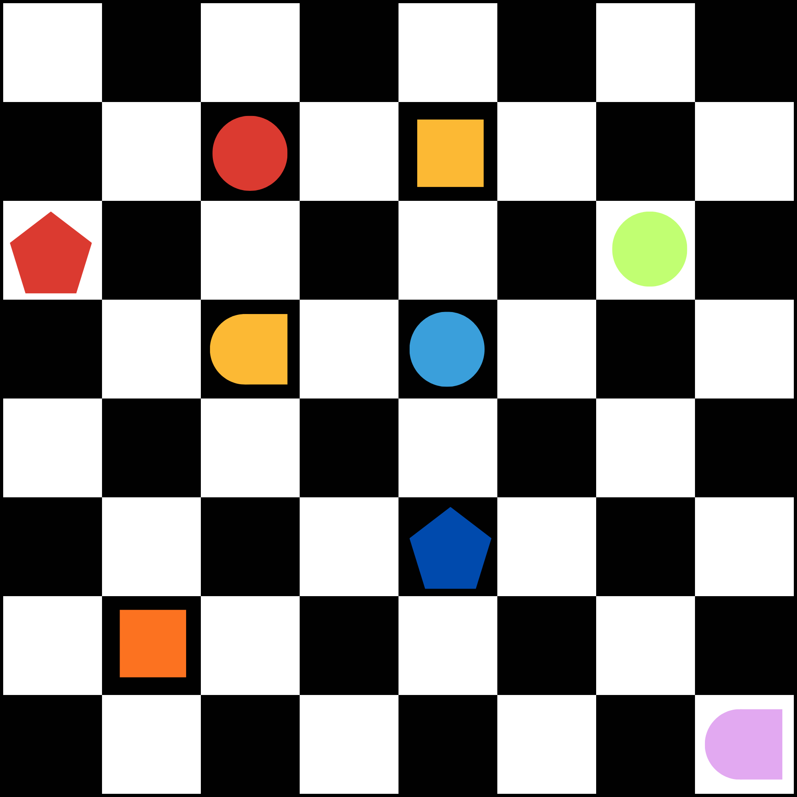</td>
    <td>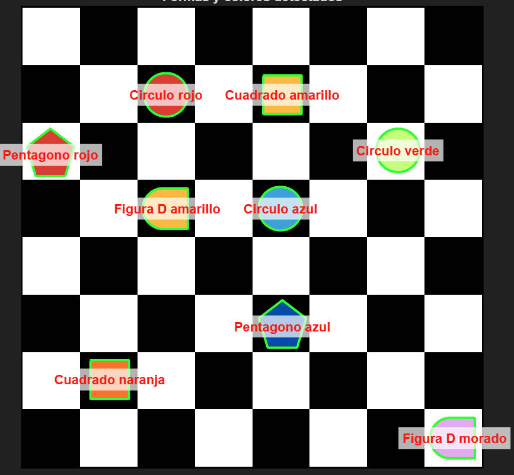</td>
  </tr>
</table>

<table>
  <tr>
    <th>Imagen original</th>
    <th>Imagen procesada</th>
  </tr>
  <tr>
    <td>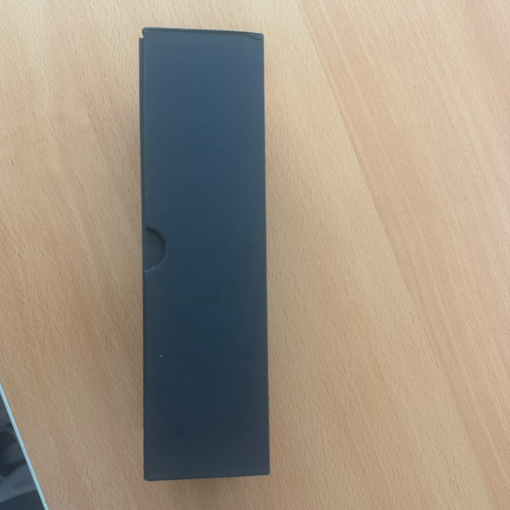</td>
    <td>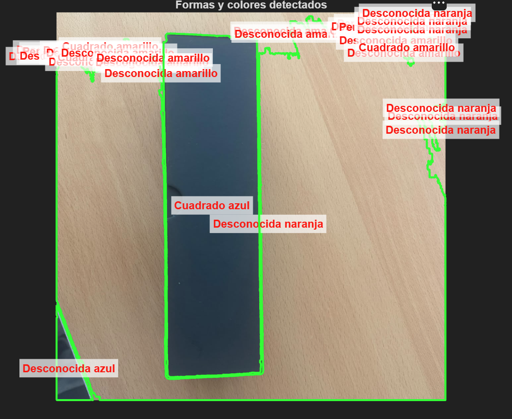</td>
  </tr>
</table>

<table>
  <tr>
    <th>Imagen original</th>
    <th>Imagen procesada</th>
  </tr>
  <tr>
    <td>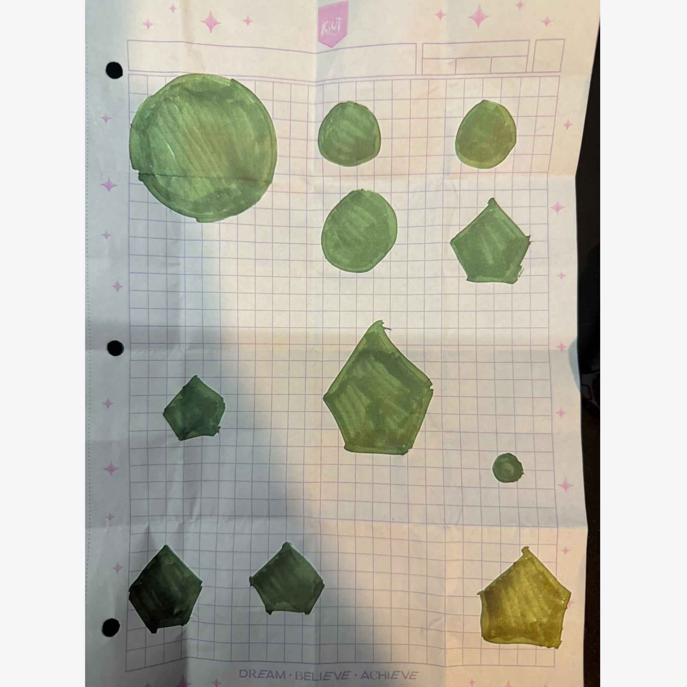</td>
    <td>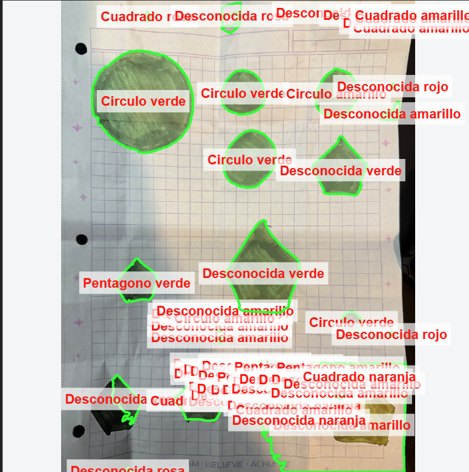</td>
  </tr>
</table>

<table>
  <tr>
    <th>Imagen original</th>
    <th>Imagen procesada</th>
  </tr>
  <tr>
    <td>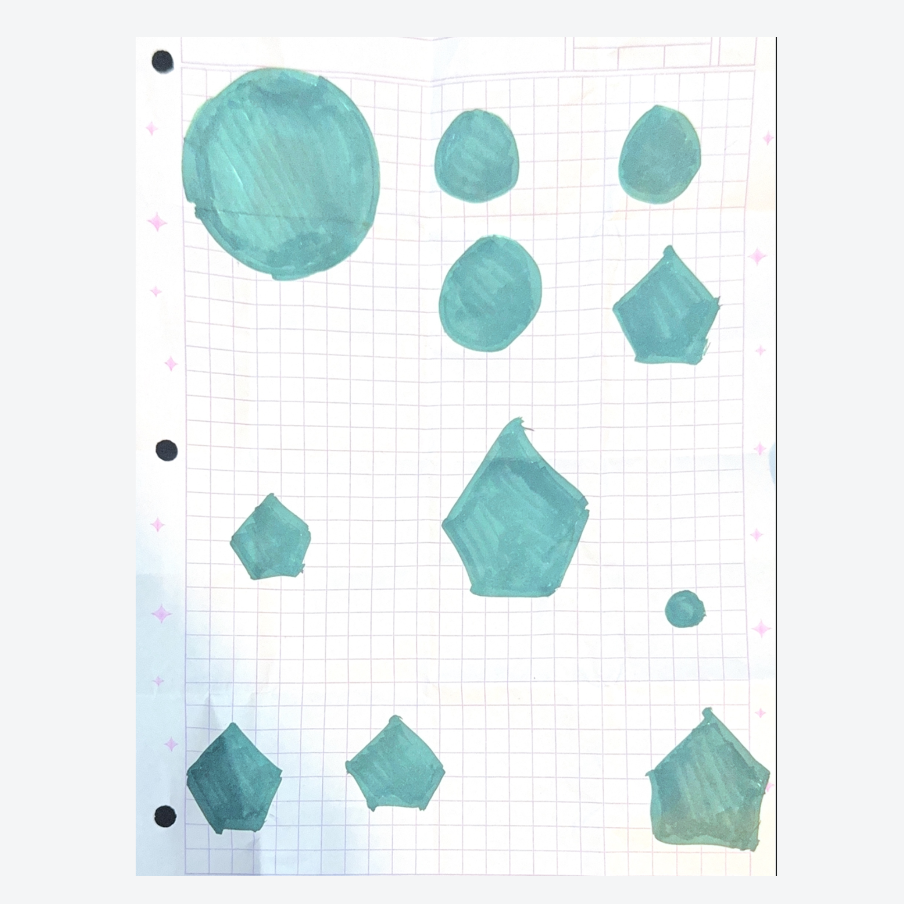</td>
    <td>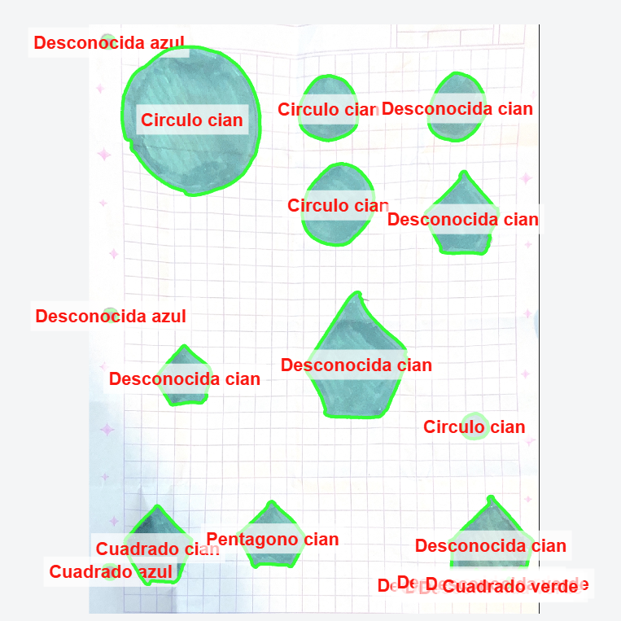</td>
  </tr>
</table>

<table>
  <tr>
    <th>Imagen original</th>
    <th>Imagen procesada</th>
  </tr>
  <tr>
    <td>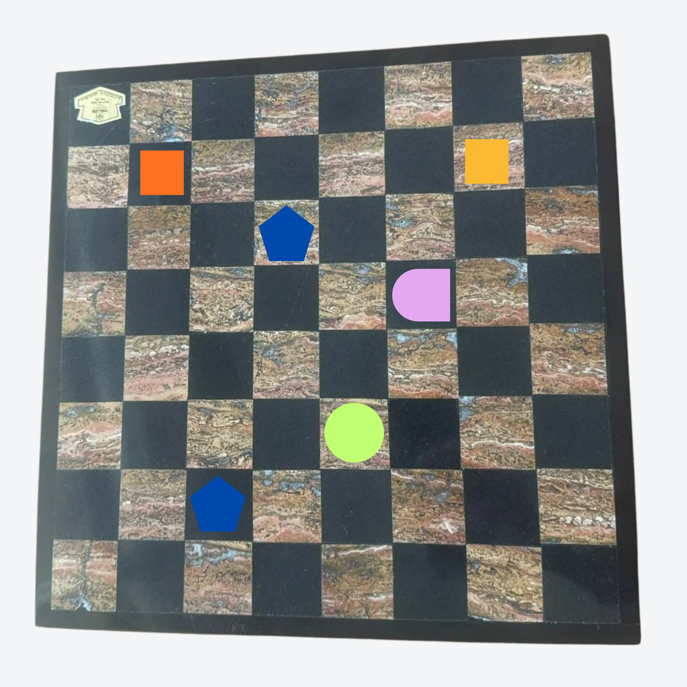</td>
    <td>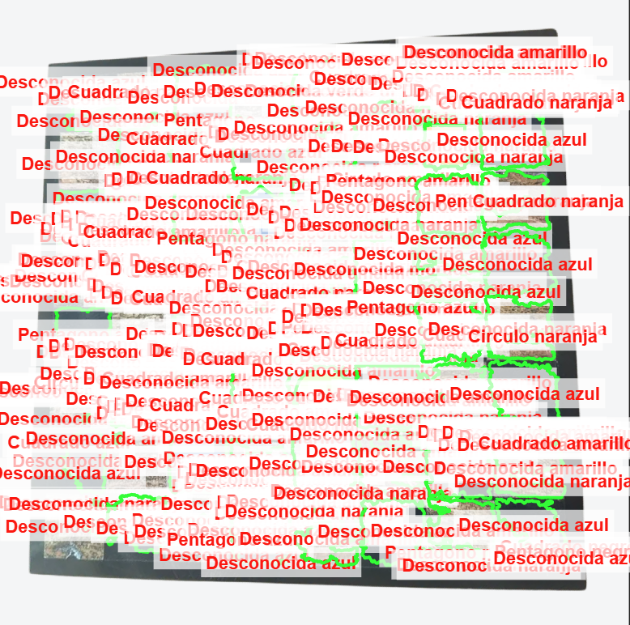</td>
  </tr>
</table>

<table>
  <tr>
    <th>Imagen original</th>
    <th>Imagen procesada</th>
  </tr>
  <tr>
    <td>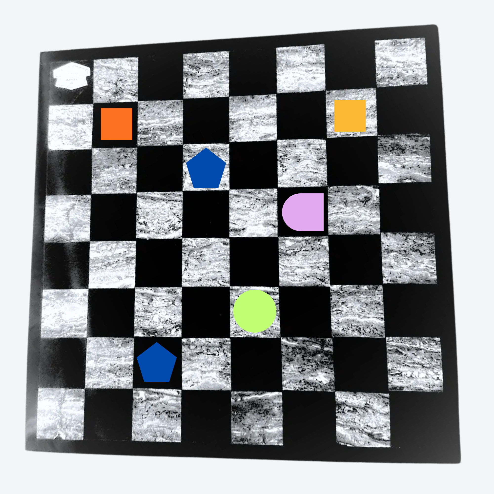</td>
    <td>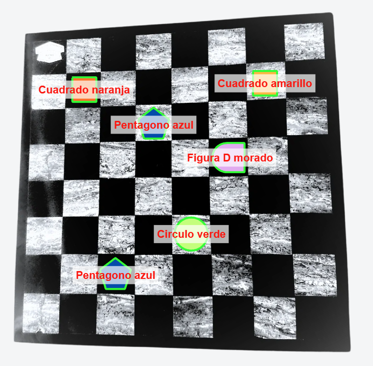</td>
  </tr>
</table>

## 4. Conclusiones

Obserbamos que ya detecta correctamente las figuras en un tablero, las cosas que debemos conciderar para ajustarlo en un ambiente real es que nuestro tablero no es negro con blanco es negro con naranja, y auqnue podemos ajustar el parametro para que ignore el negro y el naranja tambien podemos contemplar la posibilidad de usar otro tablero, otra observacion seria que actualmente todo lo que no es negro o blanco lo toma como figura es decir aun si el fondo es morado lo tomara como objeto.

## Anexos

```Matlab
function detectar_formas_tablero(nombreImagen)

    if nargin < 1
        nombreImagen = 'formas9.png';
    end

    %% 1) LEER LA IMAGEN
    I  = imread(nombreImagen);
    Id = im2double(I);
    if size(Id,3) == 1
        Id = repmat(Id, [1 1 3]);
    end
    Id = Id(:,:,1:3);   % por si el PNG trae canal alfa

    %% 2) SEGMENTAR POR SATURACION
    % El tablero es blanco y negro: su saturacion es ~0.
    % Las figuras tienen color: su saturacion es alta.
    % Asi el fondo (casillas blancas y negras) se ignora por completo.
    HSV = rgb2hsv(Id);
    S = HSV(:,:,2);
    V = HSV(:,:,3);
    BW = (S > 0.20) & (V > 0.15);

    %% 3) LIMPIAR LA IMAGEN BINARIA
    BW = imfill(BW, 'holes');
    BW = bwareaopen(BW, 200);
    BW = imopen(BW, strel('disk', 2));

    %% 4) MEDIR CADA REGION
    props = regionprops(BW, 'Area', 'Perimeter', 'Centroid', ...
        'Solidity', 'MajorAxisLength', 'MinorAxisLength', ...
        'Extent', 'PixelIdxList');

    fronteras = bwboundaries(BW, 'noholes');

    %% 5) CLASIFICAR FORMA Y COLOR, Y DIBUJAR
    figure; imshow(I); hold on;
    title('Formas y colores detectados');

    for k = 1:numel(props)
        P = fronteras{k};
        P = [P(:,2), P(:,1)];     % [fila col] -> [x y]
        P(end,:) = [];            % el ultimo punto repite al primero

        % --- Forma ---
        [nVert, nAgudas] = contar_esquinas(P);
        circ = 4*pi*props(k).Area / props(k).Perimeter^2;
        relAspecto = props(k).MajorAxisLength / props(k).MinorAxisLength;

        if nAgudas  == 4
             forma = 'Cuadrado';
            
        elseif nAgudas == 5
            forma = 'Pentagono';
        elseif nAgudas == 2 && props(k).Extent > 0.85
            forma = 'Figura D';
        elseif nAgudas == 0 && circ > 0.80
            forma = 'Circulo';
        else
            forma = 'Desconocida';
        end

        % --- Color ---
        % Mediana de R, G y B de los pixeles de ESTE objeto
        idx = props(k).PixelIdxList;
        R = Id(:,:,1); G = Id(:,:,2); B = Id(:,:,3);
        rgbObj = [median(R(idx)), median(G(idx)), median(B(idx))];
        color = nombre_color(rgbObj);

        % --- Dibujar ---
        etiqueta = sprintf('%s %s', forma, color);
        plot(P(:,1), P(:,2), 'g', 'LineWidth', 2);
        c = props(k).Centroid;
        text(c(1), c(2), etiqueta, 'Color', 'r', 'FontSize', 11, ...
            'FontWeight', 'bold', 'HorizontalAlignment', 'center', ...
            'BackgroundColor', [1 1 1 0.7]);

        fprintf(['Objeto %d: %s | color=%s | vertices=%d agudas=%d ' ...
                 'circ=%.2f extent=%.2f solidez=%.2f aspecto=%.2f\n'], ...
            k, forma, color, nVert, nAgudas, circ, ...
            props(k).Extent, props(k).Solidity, relAspecto);
    end
    hold off;
end


%  FUNCIONES AUXILIARES


function nombre = nombre_color(rgb)
% Convierte un color RGB (0-1) a un nombre usando HSV.
% H (matiz) da el "color", S (saturacion) y V (brillo) separan
% negro, gris y blanco.
    hsv = rgb2hsv(reshape(rgb, 1, 1, 3));
    h = hsv(1) * 360;   % grados
    s = hsv(2);
    v = hsv(3);

    if v < 0.20
        nombre = 'negro';
    elseif s < 0.15 && v > 0.80
        nombre = 'blanco';
    elseif s < 0.15
        nombre = 'gris';
    elseif h < 15 || h >= 345
        nombre = 'rojo';
    elseif h < 33
        nombre = 'naranja';
    elseif h < 70
        nombre = 'amarillo';
    elseif h < 170
        nombre = 'verde';
    elseif h < 190
        nombre = 'cian';
    elseif h < 260
        nombre = 'azul';
    elseif h < 300
        nombre = 'morado';
    else
        nombre = 'rosa';
    end
end

function [n, nAgudas] = contar_esquinas(P)


    perim = sum(vecnorm(diff([P; P(1,:)]), 2, 2));
    tol = 0.01 * perim;

    % Un contorno cerrado se parte en dos curvas abiertas usando el
    % punto mas lejano al primero.
    [~, i2] = max(vecnorm(P - P(1,:), 2, 2));
    curva1 = P(1:i2, :);
    curva2 = [P(i2:end, :); P(1,:)];

    k1 = douglas_peucker(curva1, tol);
    k2 = douglas_peucker(curva2, tol);

    % Vertices en orden; se quitan los dos puntos de union duplicados
    V = [curva1(k1,:); curva2(k2,:)];
    V([sum(k1)+1, end], :) = [];
    n = size(V,1);

    % Angulo interior en cada vertice
    a = circshift(V,  1, 1) - V;
    b = circshift(V, -1, 1) - V;
    c = sum(a.*b, 2) ./ (vecnorm(a,2,2) .* vecnorm(b,2,2));
    ang = acosd(max(-1, min(1, c)));

    nAgudas = sum(ang < 120);
end

function keep = douglas_peucker(P, tol)
% Devuelve un vector logico indicando que puntos se conservan.
    n = size(P,1);
    keep = false(n,1);
    keep([1 n]) = true;
    if n < 3, return; end

    a = P(1,:);  b = P(n,:);  ab = b - a;  L = norm(ab);
    if L == 0
        d = vecnorm(P - a, 2, 2);
    else
        d = abs(ab(1)*(P(:,2)-a(2)) - ab(2)*(P(:,1)-a(1))) / L;
    end

    [dmax, i] = max(d);
    if dmax > tol
        keep(1:i) = douglas_peucker(P(1:i,:), tol);
        keep(i:n) = douglas_peucker(P(i:n,:), tol);
    end
end
```